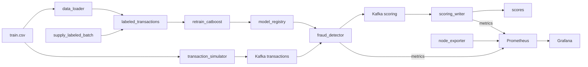

# Антифрод: поток транзакций, скоринг и переобучение

Учебный проект обнаружения мошеннических транзакций. Kafka несёт непрерывный поток событий, CatBoost скорит их текущей моделью, а Airflow по расписанию дописывает размеченные месяцы и переобучает модель. Prometheus и Grafana показывают скорость обработки, распределение скоров и смену версии модели.

---

## Архитектура



| Сервис | Описание |
|--------|----------|
| **Kafka** | Шина сообщений между симулятором потока, скорингом и записью результатов |
| **Zookeeper** | Управление кластером Kafka |
| **Kafka UI** | Просмотр топиков `transactions` и `scoring` |
| **transaction_simulator** | Бесконечно шлёт в `transactions` случайные строки CSV. У каждой новый `transaction_id` и `transaction_time`, равный текущему моменту, формат `YYYY-MM-DD HH:MM` |
| **fraud_detector** | Препроцессинг и инференс CatBoost. Перед каждым сообщением читает `/models/latest.txt` и подхватывает `my_catboost_<версия>.cbm` без перезапуска |
| **scoring_writer** | Читает топик `scoring` и пишет `score`, `fraud_flag`, `model_version`, `us_state`, `merch` и `cat_id` в PostgreSQL |
| **PostgreSQL** | Витрина `labeled_transactions`, состояние окна `training_state` и таблица `scores` |
| **data_loader** | При старте один раз загружает весь CSV в витрину и собирает исходное окно обучения: январь–март 2019 |
| **airflow** | Два DAG каждые 5 минут: поставка нового размеченного месяца и переобучение CatBoost |
| **Prometheus** | Собирает метрики `fraud_detector` (`:8000`), `scoring_writer` (`:8001`) и Node Exporter раз в секунду |
| **Grafana** | Дашборды скоринга, записи в БД, системных метрик и срезов по штату и мерчанту. Смена версии модели отмечена интервалом около 30 секунд с именем новой версии |
| **Node Exporter** | Системные метрики хоста контейнеров: CPU, память, сеть, диск |

Общий том `model_registry` смонтирован в Airflow как `/opt/airflow/models` и в `fraud_detector` как `/models`. Логика задач вынесена в `pipeline/`. Файлы в `dags/` только связывают задачи.

---

## Структура проекта

```
.
├── fraud_detector/           # Онлайн-скоринг
├── transaction_simulator/    # Непрерывная поставка транзакций в Kafka
├── scoring_writer/           # Запись скоров в PostgreSQL
├── data_loader/              # Первичная загрузка размеченной витрины
├── dags/
│   ├── retrain_catboost.py   # DAG переобучения
│   └── supply_labeled_batch.py
├── pipeline/
│   ├── db.py                 # Подключение к витрине и training_state
│   ├── retrain/              # Функции задач переобучения
│   └── supply/               # Функции задач поставки месяца
├── airflow/                  # Образ Airflow с CatBoost
├── prometheus/prometheus.yml # Источники метрик
├── grafana/                  # Datasource, provisioning и дашборды
├── docker-compose.yaml
├── .env.example
└── README.md
```

---

## Что происходит после запуска

1. `data_loader` копирует `TRAIN_DATA_CSV` в `labeled_transactions` и сохраняет окно января–марта 2019. Повторный старт без `down -v` витрину не перезаливает.
2. `transaction_simulator` каждые 0.1 секунды отправляет в Kafka случайную транзакцию с текущим временем.
3. `fraud_detector` скорит поток моделью из общего каталога. До первого переобучения версия — `initial`: в каталог копируется модель из образа.
4. `scoring_writer` складывает результат в `scores`, включая `model_version`.
5. DAG `supply_labeled_batch` каждые 5 минут берёт из витрины 100 тысяч случайных строк, переносит их время в следующий календарный месяц и дописывает батч. Наблюдения старше трёх лет относительно самого нового месяца удаляются.
6. DAG `retrain_catboost` каждые 5 минут забирает следующий месяц витрины, начиная с апреля 2019, сдвигает трёхмесячное окно, учит CatBoost и публикует `my_catboost_<timestamp>.cbm`.

Переобучение и поставка идут по разным указателям месяца. `retrain_catboost` читает исторические месяцы с апреля 2019. `supply_labeled_batch` каждый раз создаёт месяц после максимальной даты витрины, первый такой месяц — апрель 2020. Окно обучения ещё долго не доходит до этих батчей, и очистка трёх лет его не затрагивает.

Оба DAG можно запустить вручную в Airflow, не дожидаясь расписания. Если очередного месяца в витрине ещё нет, задачи переобучения помечаются как skipped.

---

## Технологии

- **Python 3.11**
- **ML**: CatBoost, pandas, numpy
- **Kafka**: потоковая обработка данных
- **PostgreSQL**: витрина размеченных данных и результаты скоринга
- **Airflow 2.10**: поставка месячных батчей и переобучение модели
- **Prometheus / Grafana**: сбор и визуализация метрик скоринга и хоста
- **Docker / Docker Compose**: оркестрация микросервисов

---

## Запуск

Нужен запущенный Docker Desktop. Дождитесь статуса Engine running: пока движок не готов, `docker compose` зависает или падает с `ECONNRESET`. Если Docker Desktop не запускает движок, перезапустите его от имени администратора. При ошибке WSL выполните `wsl --shutdown` и снова запустите Docker Desktop.

```powershell
git clone https://github.com/anyakon/MLOps_Prometheus_Grafana.git
cd MLOps_Prometheus_Grafana
copy .env.example .env
```

В `.env` укажите полный путь к размеченному `train.csv`:

```text
TRAIN_DATA_CSV=F:/путь/к/train.csv
```

Путь с пробелами указывать можно. Файл должен существовать до запуска: он монтируется в `data_loader` и `transaction_simulator`.

```powershell
docker compose up --build
```

Первый запуск долгий: скачиваются образы, `data_loader` грузит CSV в Postgres. Остановить: `Ctrl+C`, затем `docker compose down`. Данные сохранить. Полный сброс: `docker compose down -v`.

## Доступные сервисы

| Сервис | URL |
|--------|-----|
| **Kafka UI** | http://localhost:8080 |
| **Airflow** | http://localhost:8081 (`admin` / `admin`) |
| **PostgreSQL** | `localhost:5432`, база `fraud_db` |
| **Prometheus** | http://localhost:9090 |
| **Grafana** | http://localhost:3000 (`admin` / `admin`) |

При первом входе Grafana предлагает сменить пароль. Кнопка Skip оставляет `admin` / `admin`.

Пользователь и пароль Postgres задаются в `.env` (`fraud_user` / `fraud_pass` в шаблоне).

Посмотреть витрины из контейнера:

```bash
docker compose exec postgres psql -U fraud_user -d fraud_db
```

---

## Таблицы PostgreSQL

Таблица `scores`:

| Поле | Тип | Описание |
|------|-----|----------|
| id | SERIAL | Уникальный ID |
| transaction_id | TEXT | Идентификатор транзакции |
| score | FLOAT | Вероятность мошенничества, порог 0.5 |
| fraud_flag | INT | 1, если score больше 0.5, иначе 0 |
| model_version | TEXT | Версия CatBoost, которая посчитала скор |
| us_state | TEXT | Штат транзакции |
| merch | TEXT | Мерчант |
| cat_id | TEXT | Категория |
| created_at | TIMESTAMP | Время записи |

`labeled_transactions` — витрина размеченных транзакций. `training_state` хранит границы трёхмесячного окна обучения и месяц следующего батча.

Последние скоры:

```sql
SELECT transaction_id, score, fraud_flag, model_version, created_at
FROM scores
ORDER BY created_at DESC
LIMIT 20;
```

Модели, которые опубликовал DAG:

```bash
docker compose exec airflow ls -la /opt/airflow/models
```

---

## Как смотреть демонстрацию

1. В Kafka UI топик `transactions` пополняется каждые 0.1 секунды, топик `scoring` — ответами модели.
2. В Airflow откройте `supply_labeled_batch` и `retrain_catboost`. Кнопка Trigger запускает прогон сразу.
3. После публикации модели новые сообщения в `scores` получают свежий `model_version`.
4. В Grafana откройте «Скоринг потока» и «Запись скоров». Пока симулятор шлёт поток, графики скорости растут. После DAG переобучения на «Скоринг потока» появляется отметка около 30 секунд с именем новой версии. «Системные метрики» показывает CPU, память, сеть и диск.

## Проверка

1. `docker compose ps` показывает `fraud_detector`, `scoring_writer`, `prometheus`, `grafana` и `node-exporter` в состоянии `running`.
2. Откройте http://localhost:8000/metrics дважды с паузой в несколько секунд: `transactions_total` увеличивается.
3. В Prometheus выполните `rate(transactions_total[1m])` — значение больше нуля, пока идёт поток. На странице http://localhost:9090/targets все цели `UP`.
4. В Grafana на «Скоринг потока» и «Запись скоров» есть линии, а не пустые панели.
5. Запустите в Airflow `supply_labeled_batch`, затем `retrain_catboost`. После публикации новой модели запрос `model_version_updates_total` в Prometheus увеличивается, а на «Скоринг потока» появляется отметка с новой версией.
6. В таблице «Запись скоров» появляется строка с новой версией модели после того, как `scoring_writer` запишет первые скоры.

---

## Метрики

`fraud_detector`, http://localhost:8000/metrics

| Метрика | Зачем |
|---|---|
| `transactions_total` | Счётчик обработанных транзакций |
| `transaction_processing_seconds` | Время обработки одной транзакции |
| `fraud_score` | Гистограмма скоров |
| `fraud_ratio` | Доля транзакций со скором выше 0.5 |
| `model_version_updates_total{version}` | Счётчик смены версии модели |
| `high_risk_transactions_total` | Счётчик скоров не ниже 0.9. Этой метрики нет в коде семинара: доля фрода по порогу 0.5 не показывает всплеск самых опасных скоров. Смотреть на графике «Очень высокий скор» дашборда «Скоринг потока» |

`scoring_writer`, http://localhost:8001/metrics

| Метрика | Зачем |
|---|---|
| `scorings_total` | Число записанных скоров |
| `scoring_db_write_seconds` | Время записи в PostgreSQL |
| `fraud_detected_total` | Число записанных транзакций с флагом фрода |
| `scoring_fraud_score` | Гистограмма записанных скоров |

Node Exporter, порт 9100 внутри сети: CPU, память, сеть, диск.

## Дашборды

Появляются сами после старта Grafana, http://localhost:3000 (`admin` / `admin`).

| Дашборд | Ссылка | Что смотреть |
|---|---|---|
| Скоринг потока | http://localhost:3000/d/hw5-scoring-stream | скорость потока, время обработки, доля фрода, распределение скоров, очень высокий скор, отметка версии модели |
| Запись скоров | http://localhost:3000/d/hw5-score-writer | скорость и время записи, число фрода, распределение записанных скоров, таблица числа скоров и доли фрода по `model_version` из PostgreSQL |
| Системные метрики | http://localhost:3000/d/hw5-node | CPU, память, сеть, диск |
| Срезы транзакций | http://localhost:3000/d/hw5-slices | фильтры штат и мерчант, плотность скоров и TPS выбранных транзакций, доля фрода по `cat_id` за последние 1000 транзакций, доля фрода по часу суток |

Источник Prometheus подключается сам. Источник PostgreSQL тоже: база `fraud_db`, пользователь из `.env`.

## Алерты

Правила лежат в `grafana/provisioning/alerting/rules.yaml` и видны в Grafana → Alerting. Доставка в Telegram или почту не настроена.

| Правило | Порог | Как проверить |
|---|---|---|
| Доля фрода выше 1% | `fraud_ratio > 0.01` дольше 30 секунд | Открыть Alerting. Если на дашборде доля выше 1%, статус Firing |
| Поток транзакций остановился | `rate(transactions_total[1m]) < 0.05` дольше 30 секунд | `docker compose stop transaction_simulator`. Через 1–2 минуты правило Firing. `docker compose start transaction_simulator` возвращает Normal |

### Очистка

`docker compose down -v` удаляет контейнеры вместе с витриной, окном обучения, реестром моделей, состоянием Airflow и томами Prometheus и Grafana. Следующий запуск снова загрузит CSV.
